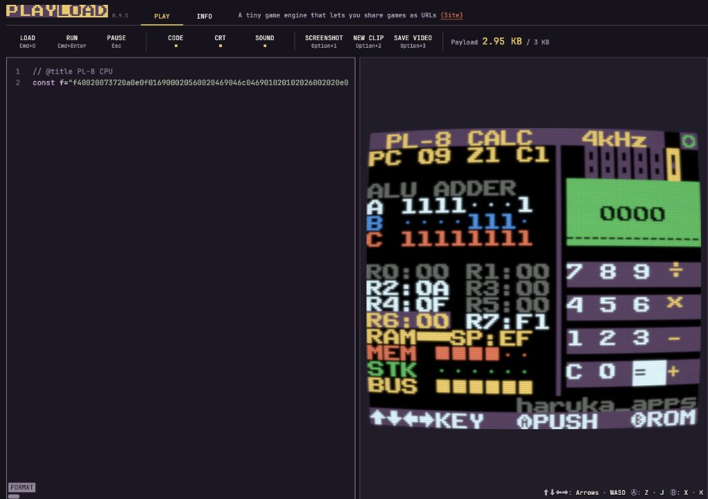

# PL-8 Microcomputer

[](https://kitao.dev/playload/app/)
[](https://kitao.dev/playload/app/)
[](docs/architecture.md)
[](LICENSE)
[](https://github.com/harukaappscreate)

Playload（3 KB 制限）上で動作する 8 ビット CPU エミュレータ、周辺回路シミュレータ、および 2 本の機械語 ROM カートリッジ（16 ビット電卓 / ブロック崩し）の実装です。

詳細な回路設計、メモリマップ、全 16 命令の仕様については [docs/architecture.md](docs/architecture.md) を参照してください。

---

## プレイ方法 (Play Online)

ブラウザで以下のリンクを開くと、Playload 上で本システムが起動します：

- **[Playload で起動する (kitao.dev)][play-online]**
- テキストファイル版 URL: [dist/url.txt](dist/url.txt)

### 操作方法
- **十字キー / WASD**: カーソル移動（電卓） / パドル移動（ブロック崩し） / クロック周波数変更（上・下）
- **Ⓐ ボタン (Z / J キー)**: キー入力 / 発射
- **Ⓑ ボタン (X / K キー)**: ROM カートリッジ交換（CALC-16 ⇄ BRICK）

---

## スクリーンショット

<p align="center">
  
  <br>
  <em>Playload 0.9.5 実機画面（Payload 2.95 KB / 3 KB 表示）</em>
</p>

---

## 1. 概要 (Overview)

`PL-8` は、Web ゲーム環境 Playload（3 KB 制限）向けに設計された 8 ビット・マイクロコンピュータです。

JavaScript によるゲームロジック直接記述ではなく、CPU コア、256 バイト SRAM、論理ゲートレベルの加算器（ALU）、メモリマップド I/O（MMIO）、蛍光表示管（VFD）、LCD コントローラー、音源を JavaScript でエミュレートし、その上でアセンブリ言語から生成した 2 本の機械語 ROM（16 ビット電卓およびブロック崩し）を実行します。

Playload の容量制約（3 KB = 3,072 バイト）に対し、圧縮後サイズ **3,013 バイト (2.95 KB / Deflate-raw)** で収容しています。

---

## 2. プラットフォーム：Playload

**[Playload](https://kitao.dev/playload/)** は、レトロゲームエンジン [Pyxel](https://github.com/kitao/pyxel)（GitHub 18.5k stars）の作者である [Takashi Kitao (@kitao)](https://github.com/kitao) 氏が開発した Web ゲーム実行環境です。

### 仕様と特徴
- **URL 駆動型**: コード、グラフィック、音声データを含む全体が URL のフラグメント（`#v1....`）内に Deflate 圧縮されて保持されます。サーバー側のデータ保持なしで URL 単体で実行可能です。
- **3 KB 容量制約**: SNS やブラウザの URL 長制限（約 4,096 文字）を考慮し、Deflate-raw 圧縮後のバイナリサイズが **3,072 バイト以内** に制限されています。
- **仮想マシン構成**: 160×128 ピクセル 8 色 CRT 表示、PCG（プログラマブル・キャラクタ・ジェネレータ）機能、3 チャンネル AY-3-8910 準拠音源を備えています。

本プロジェクトでは、3 KB の容量枠内に CPU・周辺回路のエミュレータと 2 本の機械語 ROM を実装しています。

- **Playload 公式サイト**: [https://kitao.dev/playload/](https://kitao.dev/playload/)
- **Playload Web アプリ**: [https://kitao.dev/playload/app/](https://kitao.dev/playload/app/)
- **開発者**: [Takashi Kitao (@kitao)](https://github.com/kitao)

---

## 3. システム構成 (System Architecture)

```
+-----------------------------------------------------------------------+
|                       PL-8 Microcomputer System                       |
|                                                                       |
|  +--------------------+   +-------------------+   +----------------+  |
|  |     PL-8 CPU       |   |  Ripple-Carry ALU |   | 256-byte SRAM  |  |
|  | 8-bit Data Bus     |<--| Full Adder Gates  |-->| $00 - $FF      |  |
|  | PC, SP, R0-R7, Z, C|   | A, B, Carry LEDs  |   | MEM/STK Monitor|  |
|  +--------------------+   +-------------------+   +----------------+  |
|            |                                              |           |
|            +-------------------+--------------------------+           |
|                                | Memory-Mapped I/O (MMIO)             |
|  +-----------------------------+-----------------------------------+  |
|  |                                                                 |  |
|  |  [$F0] Gamepad Latch (Left, Right, Fire)                        |  |
|  |  [$F1] 4x4 Tactile Keypad Latch (0-9, +,-,*,/,=,C)              |  |
|  |  [$F2-$F7] 6-Digit 7-Segment VFD Controller (Phosphor Glow)     |  |
|  |  [$FC] Piezoelectric Sound Latch (Pitch / Frequency)            |  |
|  |  [$FD] Hardware LFSR Random Number Generator                    |  |
|  |  [$FE] CPU Busy / Thinking State Latch                          |  |
|  |                                                                 |  |
|  +-----------------------------------------------------------------+  |
|                                |                                      |
|  +--------------------+   +----+--------------+   +----------------+  |
|  | 64x32 Green LCD    |   | 2-in-1 ROM Slot   |   | Tactile Keypad |  |
|  | 32 Dynamic PCG     |   | [B] Button Swap   |   | 4x4 Matrix     |  |
|  | Tile Engine        |   | CALC-16 / BRICK   |   | Keycap Shadow  |  |
|  +--------------------+   +-------------------+   +----------------+  |
+-----------------------------------------------------------------------+
```

### 主要スペック要約
| 項目 | 仕様 |
| :--- | :--- |
| **CPU アーキテクチャ** | 独自 8 ビット CPU、16 ビット固定長命令ワード |
| **レジスタ** | 汎用 8 本 (`R0`〜`R7`)、`PC`, `SP`, `Z` (Zero), `C` (Carry) |
| **ALU 演算方式** | 1 ビット全加算器 8 段接続によるリップルキャリー論理回路 |
| **RAM 容量** | 256 バイト SRAM（`$00`〜`$FF`、スタック初期値 `$EF`） |
| **I/O ポート** | メモリマップド I/O（ゲームパッド、テンキー、VFD、音源、乱数） |
| **ディスプレイ** | 6 桁 7 セグメント VFD ＋ 64×32 ドット PCG グラフィック LCD |
| **クロック周波数** | 可変 5 段階（STEP, 15Hz, 240Hz, 4kHz, 27kHz） |

> 各コンポーネントの詳細回路図、真理値表、メモリマップ、全 16 命令のバイナリフォーマットは **[docs/architecture.md](docs/architecture.md)** を参照してください。

---

## 4. 内蔵 ROM カートリッジ

Ⓑ ボタンで実行対象の ROM を切り替えます：

| カートリッジ名 | ワード数 | ソース | 概要 |
| :--- | :---: | :---: | :--- |
| **ROM 0: CALC-16** | **251 words** | [`roms/calc.asm`](roms/calc.asm) | 16 ビット 4 則演算電卓（加減乗除、符号反転、ゼロ除算検知、筆算割り算による小数部計算、起動時入力デモ内蔵） |
| **ROM 1: BRICK** | **212 words** | [`roms/brick.asm`](roms/brick.asm) | 24 ブロック崩し（壁・天井・パドルの反射物理、パドル移動による角度付け、残機 3 機、スコア表示、面クリア時再配置） |

---

## 5. 開発手順 (Development)

各ディレクトリの連携フローです：

```text
  [ roms/*.asm ]               アセンブリソース
        │
        ▼ (node tools/asm.mjs)
  [ tools/asm.mjs ]            アセンブラが機械語 Hex を生成
        │
        ▼ (src に Hex を反映)
  [ src/pl8-cartridge.src.js ] CPU エミュレータ本体 (const RH = 'Hex,Hex')
        │
        ▼ (Playload エディタにペースト)
  [ Playload (kitao.dev) ]     ブラウザ上で実行
```

### 5.1 `roms/`: アセンブリの記述
`roms/` 内の `.asm` ファイルにアセンブリコードを記述します：

```asm
; 7セグ VFD に '123' と出力して待機する例
SEG0 = $F2
SEG1 = $F3
SEG2 = $F4

start:
  LDI R0, 1
  ST [SEG0], R0
  LDI R0, 2
  ST [SEG1], R0
  LDI R0, 3
  ST [SEG2], R0

loop:
  WFI                ; フレーム待機
  JMP loop
```

### 5.2 `tools/`: アセンブラ CLI
Node.js 標準機能のみでアセンブルを実行します：

```bash
# 既存の ROM をアセンブル
node tools/asm.mjs roms/calc.asm
node tools/asm.mjs roms/brick.asm

# 任意のソースをアセンブル
node tools/asm.mjs roms/my_program.asm
```

**出力例**:
```text
Assembled roms/my_program.asm: 12 words (24 bytes)
Hex representation:
001002f2002002f3003002f40f000806
```

### 5.3 `src/`: エミュレータへの組み込み
`src/pl8-cartridge.src.js` の 4 行目に ROM の機械語 Hex が格納されています：

```javascript
// src/pl8-cartridge.src.js
const RH = 'f40020...[ROM 0 Hex]...,002000...[ROM 1 Hex]...'.split(',');
```
生成された Hex 文字列をここへ設定することで ROM を差し替えます。

### 5.4 Playload 上での実行
1. [https://kitao.dev/playload/app/](https://kitao.dev/playload/app/) を開きます。
2. `src/pl8-cartridge.src.js` または `dist/pl8-cartridge.min.js` の内容を左ペインのエディタに貼り付けます。
3. `Cmd + Enter`（または `RUN`）を押すと実行されます。

---

## 6. クイックスタート & ディレクトリ構成 (Quick Start)

Node.js（v18 以上）で各スクリプトを実行可能です。外部ライブラリへの依存はありません。

```bash
# クローン
git clone https://github.com/harukaappscreate/pl8-computer.git
cd pl8-computer

# アセンブル
npm run asm:calc
npm run asm:brick

# カートリッジ整合性検証 & サイズ計測 (または npm test)
npm run build
```

### ディレクトリ構成
```text
pl8-computer/
├── .editorconfig               # エディタ共通設定 (LF, インデント 2)
├── .gitattributes              # Git 改行設定 (全環境 LF)
├── .gitignore                  # Git 除外設定
├── LICENSE                     # MIT License (haruka_apps)
├── README.md                   # 仕様・開発マニュアル
├── package.json                # npm スクリプト定義
├── playload-screen-2.95kb.jpg  # Playload 0.9.5 実機スクリーンショット
├── dist/
│   ├── pl8-cartridge.min.js    # 2.95 KB 最小化済みカートリッジコード
│   └── url.txt                 # Playload 本番稼働 URL (テキスト)
├── docs/
│   └── architecture.md         # ハードウェア設計仕様書・命令セット詳細
├── roms/
│   ├── calc.asm                # CALC-16 機械語アセンブリ (251 words)
│   └── brick.asm               # BRICK 機械語アセンブリ (212 words)
├── src/
│   └── pl8-cartridge.src.js    # カートリッジソースコード
└── tools/
    ├── asm.mjs                 # PL-8 アセンブラ CLI
    └── build.mjs               # 整合性検証 & Deflate 計測ツール
```

---

## 7. クレジット & ライセンス

- **Hardware & Software Design**: [harukaappscreate](https://github.com/harukaappscreate) (`haruka_apps`)
- **Platform**: Playload 0.9.5 by [Takashi Kitao (@kitao)](https://github.com/kitao)
- **License**: [MIT License](LICENSE)

<!-- Reference Links -->
[play-online]: https://kitao.dev/playload/app/#v1.fThdbxvHdu_3V9BbeLDjPZTPmZmdXX4MWZlWkcISJEhxgJSgi_2YkQXTEkGRga9DF_cWt-1DHwpcBMlb0b7nuXlv_ol-SXtmSTlNm0re2Znz_b0jP3_e-8vNzWbpexen_bI3u3j9u-fPe8e9ta-WvbJf32wYNuz5b_z6972qbZ_fb-vnzd37VbX2vfX29r63ebu-216_7VW962rj-0v_jV_21jer1dL3m2rdsfn10e-au9v7TS-4JBhEhVjoQmGFHgOSHSDDcsursQM0tolvQhUfFTEKPZZIWMUnGIUdVKFmOjJUI6FHJrakUJHfcwwQrUeb_w96JCJF2uQDPDzWWDNAzzRkrWVLqI7n7sHCI0XuEi1aYulYsFRdmKJCNqjD1Hh4M9Iqq_mERpmSteSISGg5CM2erjBF3trOapajUKkSCyyI6fkd92gpEBrM0UaYKXKbV2hNE-VqbG1gCQXr9aiMKQaoC_asQjIDZBv46eC862wPRMaYGjEPhTKdjpBzlHhnC4_8oEGL0ZqGKfMSQ65Na5kukLXF_tejtbnlPGobikDsUvBYBv7xVY0YKHheMZAKDQYfsMIWvTJcHqiR9SL7WQU_wBxrNKgxxjum0CJhjhpNW6GyHJoYNNSDoqhbRNN49IOouYsXRo2xoDRWqsRaVdhog6rUVOYd3JS5rtHoAdbB4iAURRHyfO-pCixJk65DgXX0hULLtihDSumQU62V0VRidMF0Mgkthqi5W6IeMipvWwaEkiGKEKkKPjSF2tM-Pkwb_TiIIKRco8oVGtaHFLi2VSiwQvRNCEGRDgGxpFCgxRIrPqENCosQMDzazp04QBNtLKKKuosvITZIpA5mcMI5J2R1gUoTmhBrDLtaOzRWgZxHxUWNCLHVu9aJ-EMD4iNHt-uaOsduEHDLkrKU0wCNalAr9Xiq44logKR4h0qpyLffMy-SRYWD2OIWDTZosI5yUdk93WdcBz9ADVtCmli_ie17wHRaGM9NjuqX2DJKYj5FB1g3eg7auUZyxd4UHOciFqwiKuLvAAvVktVWD9DaOL201Uoj8TjobOWneoyPjpJxr1NxOxksuMyJUarQTdeaShc6by117WwoD3nYj9FDdgJRFet10AwwBMPFFGxX4rEsylgg3GwDLAIS1prK0Pg84GN7KdSxvRBLzHU3Y7l927iyBkVYRhiZ0BQt1kgFYV1Ed4iLOtd-3y5cfxqbwOkxEcfy8hhQz1Cq47QnRK2wpTwENKwjcNly-g0WwUcOiyoE1DxmjCIuz0EIsTxyNKExQcdC1ga9VrElNCrVxsK0hCFEPYcC57O1itqCpZqo31AVGqw4ViVhWRJ6pUJjufk40DGeSDGm_GNRY2xP5NZXhcIyNOxbsIjUNvGrpxSiKXGACuugsAoaMTm6Xy1vNmkCiQTv5snVlycXCSSUf_ExgUQZjG_zrjsW_F5A6-ZWg4UBQTEAQgWEAyCVQwGkCiAisAZI0QIaF9wkVbndBXm0ubvarG9ur1Oy8uh-edP4lBj6erXy61l171M5WvpNr4YtrOAU7mANM7iEj7CEd3AD97Bx8wVUvLzk5YKXW16uHMGxI5vDtUM4cwpOnIIPjkbdTeHcpQE8tNJNvmUVDdSwdQgrh6Nwt07XLsDMeeFUnsOlw9FqXI5WWSYbFyaTlSCone82251Lmzf1m1aOxyu43Lm0dY2odwyUIkJHa7_Zrm97p-7JFu5cC-92TsH2E3wdzZBukp66J-nFPCycl_DRBQmv9xZC48pnPkvDZKIl1I5UOZmkhQhSukkYWyOEH2slRHo7bxaunfJrVw_5Jf6ulvA2hnzpAmslULl2Lkxfsq5jdzyZ0JuUxLEQVBo5ZLCE949m7dkMvNzb9sp5N_m2C2LrwvzKec5qe7T0t9ebt89NDB-HNDiV21Ho90dyw8xh3AiRpQl-SLL26H5b32_WqXoWQEkJFVPg7n-jm-xAEi0IE2VIhLEypRCUw23k-4XOstN40cG37tTdxbQqPYCPrh_zNjVD_Qm-cal8dCW4zXy7AO8qfrWcZAONK0ToEm1g7S7mhfALmLmLebOAS7fNvODyWDo_UbmZXsyLxdCPbkJ64xC2bptRxLdjK5Vz7TR9ny5hxvlt5NAw5DydgcrzNx5IDr9OG2inxPC36VIO9YHCA8rhTPihlyO_vPe9m5Ba51qZO1c_ylgfZNTTepxHcD1R04garoGYFllovdvdyaHl80ysh0XcvFkPZ7v1cP1ZQ8EaWJ4fRykinY3HtEu9EHdSDmeTCR8mSoi78biQEu4cU84mk2JIYvYopx2TlnOCU3jCLfzkbjFv--VCiHTrLj-rI33Qt3cIUEo43e1-RcZx2-2Uc418n64gnqfb4VrCyq36XcQj8NcKGsnszLd1b9OVW3Xp-UygGdcl-f8mMExwexRulssUJfdFGXHfxt3nGsRRGKe5c82UcuF3O4XDUo5ClskDTetw1O5p6t3OGiZos0y-Ti_mZpG1cDHPF1mASOGHq-Z6nvCVxOS2KAdZ_-cffv7JHR2_mL08-atkvn6q1GJxtKq40UScEK0cFc41QkSBLkotozufOnccfYIXcTScOS0CnHDNK3g5V4YWPGUOzZgU5aA1uW1I6Tqgr5I4I-6dlaOwvW02N3e3vc1N8y6VcZQGWMIGKjiG8xiT4PZToN7crtIghUg_OJQR90GI66flmIS4nhRCXI8LJcSL9KC5ynNdlpVP5tfPyz4tpIQoJGchr1LqX0lYLavfpwjJV4Nz04RqlkgJV9OU_cCFM8_qzW2qZFbGjZYZ2bgze1EohajHRog6yzoIMUSIut-Xw_SR5mSCQqQn_X6nkCD5Kj_Pm-RgEnOdjDXTZNlv0CgpxFmUc_abcjTTRDlnvynHsPsv0pPxWO3O5Gei8jz3iZQS3jnkTyNC34ABW4LJcTGv-VO5meB0M3zCDnaidrsNJ8GMaVT1-71o3jephCfpjRCbCUk56nKVVu7lXOVqIafpL4KeZKnK0uo5qR1KmSV_kRyt_cpXm7R6SkpmSZPw7GZGh3JIgvdmwTo1Jz6KUpB8Zc5tkiWNv66TuRbbhYRmec99duw6FlhtNykCQtL9h0KSpVfT5MXlX89eJcNkdnw66yUyS3pJ5uc1d0N7tanWmzSPQLBAMoqgASCQOJ4mDz_8SzJMHn745ySe9TA_0CAQJBezXpI16Zb5_ybJetlplvRmvLkDe6DTkByfvu4dv3x5cpmAEu-mdqgkBKe7qu-oTBYgOX4x496JJsY70DzeZxbcT58vQ-oXd6G1Xy2rxh8vl2mCCST_-VMiYV6AAR25DrbqLMA8OTs5SyC5-vLVf1O-eH2VLA7Kkofv_-0xLWEaJjTNo6E0PKs2b4_eVx9SBKUH_ZUcGsmhO7ltU3tQqCEHGxXGStgrVZBcHp8lWcqykofv_vjw3R85nN_94eG7P3Amri6GHL-VhPwQlnOnYqAtPI6F_RfYc5aNysKim6SuGC0Zfb9ap-WzkBGabI6gQAFCX_E_XMyXC5gbKIEsUMFrCUQRvHyq2ai_Z4u-_zGBds7DeDGZLAVNz4ckR6RK4YX4rGDAApKjBAr5qZtcWv3KxvnBurKzzs-XC3c7L5-l5bPuipYtZRavZ4sRT-0uqUdhffd-9rZaz-5an-aFNiYLMk5s57uiVB0X6MNV7__jBIT8YCMd4hiEiJIIAkTPuZjDuOzA4al6ZqGM0klCcplkIUtigi5iKX3ka6Ed8mFaDFV3piHK0cH5J1c83rqp41wYVY7Dt9tdCREmWogwLuJYSedqX6F9s5BTPfTTYkjRTfUs1SLIjBSoGDAezcCfmJ9_Mrn9-QdSuj9Dlx0aBaqxmkaeiZraYTFEqORvihpA8vD9nx6-_1MCTPfpXoh7HrXbTdol92213r6r_rZare4TUI_9UwCPkocf_-HhX__94vhl7-HP_3E8-7L38OM_Pvz4T1987HERxX1H8urk6x7TXLy--qIXh87Dn3-6PD9L-C8eCddZ9ulVinL0Xw
